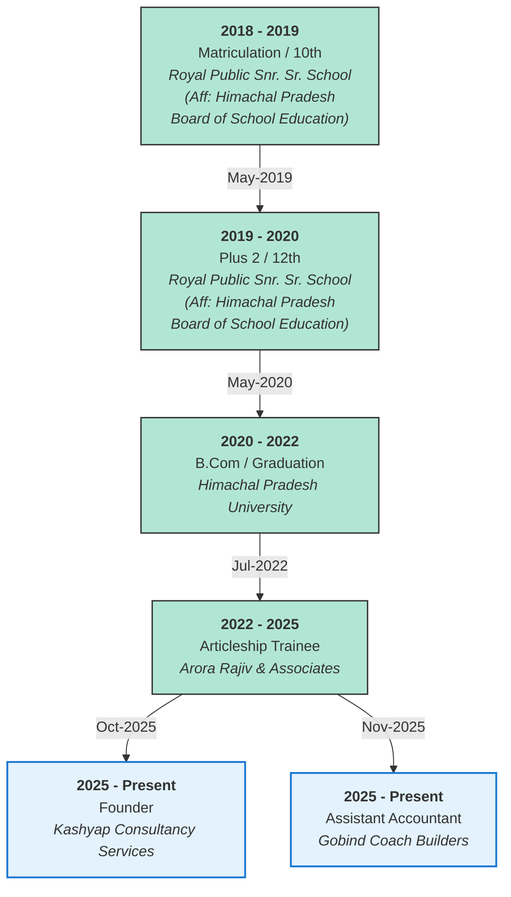
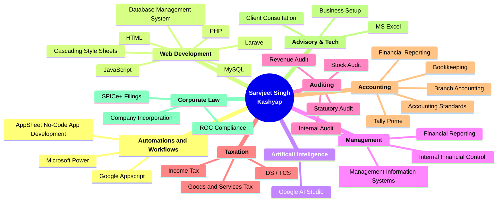

    SARVJEET SINGH KASHYAP 
    V.P.O Lodhimajra, Baddi, Solan, Himachal Pradesh - 174101 
    Email: sarvjeetsinghkashyap@gmail.com

 

## 💫 About Me: Sarvjeet Singh Kashyap
👋 Hi, I’m Sarvjeet Singh Kashyap 🚀 Laravel & Full-Stack Developer I am a results-driven Software Developer with a deep focus on the Laravel ecosystem. I specialize in building scalable web applications, designing efficient database architectures, and integrating complex APIs. With a background that bridges Information Technology and Accounting (ICAI), I bring a unique analytical approach to solving business problems through code.  🛠 Tech Stack Backend: PHP (Laravel), MySQL  Frontend: JavaScript, Blade  📈 What I Do  Full-Stack Solutions: Creating seamless user experiences from database to UI.  Performance Optimization: Refactoring legacy code and optimizing SQL queries for speed and scale.  FinTech Logic: Leveraging my accounting background to build precise financial and ERP modules.  📫 Connect with Me LinkedIn: linkedin.com/in/sarvjeetsinghkashyap

## Career and Experience

## Skills

## 🌐 Socials:
    

# 💻 Tech Stack:
               
# 📊 GitHub Stats:
 
 

## 🏆 GitHub Trophies

### ✍️ Random Dev Quote

### 🔝 Top Contributed Repo

---

<!-- Proudly created with GPRM ( https://gprm.itsvg.in ) -->
